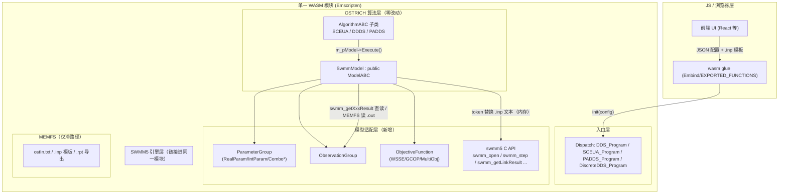
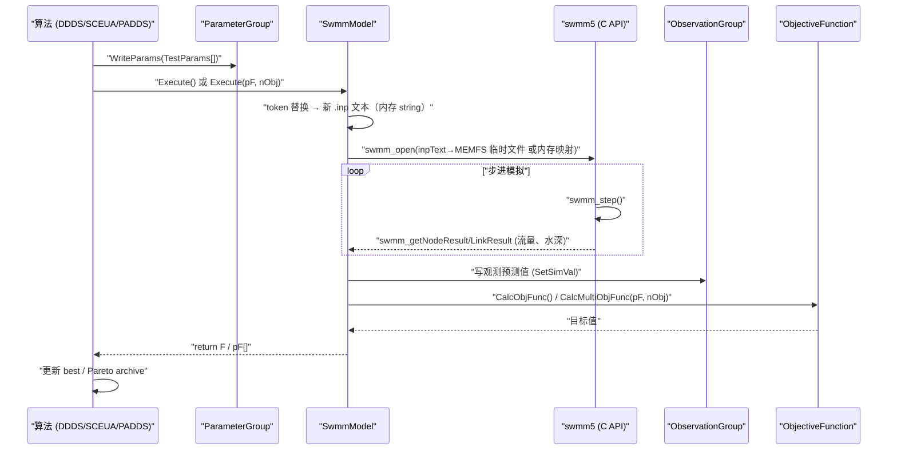

# 关于 ostrich 和 SWMM C 代码集成方案

关于 ostrich 是否 和 SWMM C 代码集成，以便在 WASM 中方便进程间调用，而非文件模式？还是内存文件模式？我已实现 swmm-wasm /swmm-js 的内存文件系统的 .inp 、.out 的调用。请整体评估采用什么方案合理，并给出最佳实践建议

**结论**：推荐自定义 ModelABC 子类直接链接 SWMM C API（同进程函数调用），而非文件模式；MEMFS 仅作为参数模板替换和 .out 解析的中间载体。 OSTRICH 的 Model 类本就为"黑盒外部模型"设计，其 Execute() 管线核心是 system(m_ExecCmd) 调用——这在 WASM 中不可用，因此必须绕过或替换 Model 层的执行路径 Model.cpp:1561-1563 。

# 三种方案对比

| 方案                               | 可行性     | 评估                                                                                            |
| -------------------------------- | ------- | --------------------------------------------------------------------------------------------- |
| A. 文件模式（fork/exec）               | ❌       | system(m_ExecCmd)、MY_CHDIR、子目录机制在 WASM 中不存在 Model.cpp:1260-1269\                              |
| B. 内存文件模式（MEMFS）                 | ⚠️ 部分可行 | 你已实现的 swmm-wasm MEMFS 可以保留 .inp 读写语义，但 OSTRICH 侧仍需绕过 system()，且每次评估都要做"模板替换→写文件→解析.out"的文本往返\ |
| C. 自定义 ModelABC 子类 + 直接 C API 调用 | ✅ 最佳    | 算法只依赖 ModelABC 接口（Execute()、GetObjFuncVal() 等），无需改动任何算法代码 Model.h:52-74\                      |

# 为什么方案 C 最优

Model::Execute() 的管线是五步：参数替换 → system() → 提取观测 → CalcObjFunc() → 返回 Model.cpp:1515-1606 。方案 C 只需替换中间三步为：

```typescript
// SwmmModel::Execute() 伪代码

m_Counter++;\
swmm_open_in_memory(inpText);         // 你已实现的 MEMFS .inp
pParamGroup->SubIntoFile(...);        // 或直接在 inp 字符串上替换 token
swmm_run / swmm_step(...);            // 直接 C 调用，无进程间开销

// 用 SWMM 输出 API（swmm_getNodeResult 等）填观测值，
// 或走 MEMFS 读 .rpt/.out 后用现有 ValueExtractor 解析
double val = m_pObjFunc->CalcObjFunc();
return val;
```

- 性能：SWMM 率定需成千上万次模拟，直接函数调用避免每次模拟的文本 I/O；swmm5 的 swmm_run/swmm_step API 本就支持进程内步进执行。
- 代码复用：算法层（DDS/SCEUA/PADDS）完全不动——它们只持有 ModelABC * m_pModel 。
- 已有先例：OSTRICH 内部就有 DisklessExecute() 模式（Isotherm()/McCammon() 等内嵌函数模型）和多目标 Execute(double* pF, int nObj) 接口 Model.cpp:1324-1343 Model.cpp:1226-1293 ——SwmmModel 相当于把"internal model"机制泛化为可注册的 C 回调，而不是按 strcmp(m_ExecCmd, "Isotherm()") 硬编码 Model.cpp:1549-1557 。

## 最佳实践建议

- 新建 SwmmModel : public ModelABC：内部直接调用 swmm C API；.inp 模板替换仍可用 ParameterGroup::SubIntoFile/FilePipe 机制生成字符串（无需真实文件），或直接字符串替换 Model.cpp:1515-1522 。
- 观测提取两条路：优先用 SWMM 输出 API 直接取数；若已有 .out 解析链路，可走 MEMFS 写 .out → 复用 ObservationGroup/ValueExtractor Model.cpp:1583-1587 。
- 多目标调度走 Execute(double* pF, int nObj) 分支，直接填充 pF[] 跳过文件解析 Model.cpp:1226-1248 。
- 裁剪 WASM 不可用特性：m_bCaching/CheckCache（读 OstModel0.txt）、PreserveModel、m_pFileCleanupList、SuperMUSE 分支均可禁用 Model.cpp:1537-1547 Model.cpp:1615-1677 。
- 保留 MEMFS 的用途：仅用于 GetInFileName() 读 ostIn.txt 配置、.inp 模板源文件、以及最终导出 .out/报告给前端——而非每次模拟的热路径。

## Notes

- Model 构造函数大量依赖 fopen(GetInFileName())、MY_ACCESS、system("cp ...") 做文件对暂存 Model.cpp:255-301 ，这是方案 B（直接用原生 Model）在 WASM 中不可行的深层原因，不只是 system(m_ExecCmd) 一处。
- 若想最小改动复用原生 Model，可设 m_InternalModel=true 并在 StdExecute 的 strcmp 分支里加一个 "Swmm()" 入口——但自定义 ModelABC 子类更干净、不影响原生 Model 的构造逻辑

# C方案的顶层架构

**顶层架构**：单一 WASM 模块内，SwmmModel（新写的 ModelABC 子类）直接调用 swmm5 C API；OSTRICH 算法层零改动，只认 ModelABC * m_pModel 指针。 PADDS.h:62-66 MEMFS 只用于配置文件/模板输入和最终报告导出，不进评估热路径。

## 方案 C 顶层架构



- OSTRICH 已有 ModelABC 多态先例：Model（system() 外部模型）和 SurrogateModel 并存，SwmmModel 是第三个同构实现 Model.h:139-185 。

## 代码目录逻辑架构（仅供参考，待评定修正）

```html
<pre><code>## 代码目录逻辑架构
swmm-ostrich-wasm
├── third_party
│   ├── ostrich/                          # OSTRICH 源码头 + 源文件
│   │   ├── include/                      # AlgorithmABC.h, ModelABC.h, MyTypes.h ...
│   │   └── src/
│   │       ├── DDSAlgorithm.cpp          # 保留
│   │       ├── DiscreteDDSAlgorithm.cpp  # 保留（泵闸离散调度）
│   │       ├── SCEUA.cpp                 # 保留（SCS-CN 率定）
│   │       ├── PADDS.cpp / SMOOTH.cpp    # 保留（多目标），多目标主力 + 管线验证
│   │       ├── NSGAII_Algorithm.cpp      # 【可选】多目标：Pareto 前沿覆盖度优先  
│   │       ├── MOPSOCD_Algorithm.cpp     # 【可选】多目标：注意学术许可证  
│   │       │   + MOPSOCD_RandomLib.cpp   # （其专用随机数库，必须连带）  
│   │       ├── PAES_*.cpp                # 【可选】PAES 全套 4 文件  
│   │       ├── ParameterGroup.cpp / Parameter.cpp / ComboParam.cpp
│   │       ├── ObservationGroup.cpp / ObjectiveFunction.cpp / GCOP.cpp
│   │       └── Model.cpp                 # 不链接或仅作参考（依赖 system()/MPI）
│   └── swmm5/                            # EPA-SWMM 5.x C 源码
│       └── (swmm5.c, runoff.c, routing.c, output.c ...)
├── wasm_bridge/
│   ├── SwmmModel.h / SwmmModel.cpp       # 【新增】ModelABC 子类
│   ├── SwmmInpPatcher.cpp                # 【新增】.inp 内存 token 替换（复用 FilePair/SubIntoFile 逻辑或独立实现）
│   ├── SwmmResultReader.cpp              # 【新增】封装 swmm_get*Result / .out 二进制解析 → 填 ObservationGroup
│   ├── OstrichConfig.cpp                 # 【新增】JSON/字符串 → ostIn.txt 等价的参数解析（绕过 fopen(GetInFileName())）
│   └── WasmExports.cpp                   # 【新增】extern "C"/EMSCRIPTEN_BINDINGS：init/run/step/cancel
├── wasm_include/
│   └── mpi_stub.h                        # 【新增】MPI_Comm_rank→0, MPI_Comm_size→1 桩
└── CMakeLists.txt / emcc                 # 构建脚本
</code></pre>
```

- 关键裁剪点：Model::Execute() 三分支（DisklessExecute/StdExecute/DecisionModule）全部不走，SwmmModel::Execute 自实现 Model.cpp:1199-1220 ；Bookkeep 的 nprocs==1 早退由 MPI stub 自然满足 Model.cpp:1499-1502 。

## 加入时的注意事项：

- MPI 引用无需删：MOPSOCD_Algorithm.cpp 顶部 #include <mpi.h> 由 mpi_stub.h 拦截，MPI_Comm_size→1 使 if(nprocs > 1) evaluate_parallel(...) 自动走 evaluate() 串行分支 -- MOPSOCD_Algorithm.cpp:40 MOPSOCD_Algorithm.cpp:223-231 。
- 依赖完整性：MOPSOCD 依赖 MOPSOCD_RandomLib（Marsaglia-Zaman 随机数）必须一并编译 MOPSOCD_Algorithm.h:48 ；NSGA-II 自带全部数据结构（NSGAII_Individual/NSGAII_GlobPop），相对独立。
- 文件 I/O：Optimize() 中 fopen("MOPSOCD_output.out") 等输出需走 MEMFS 或裁剪，与其他算法相同处理 MOPSOCD_Algorithm.cpp:199-201 。\
  导出：MOPSOCD_Program 同为 extern "C" 入口 MOPSOCD_Algorithm.h:130-132 。

## Notes

- 建议策略：目录中保留源文件、构建时用 CMake option（如 OSTRICH_WASM_ALGS=SCEUA;DDDS;PADDS;NSGAII）按需编译进 WASM，避免一次性塞入全部算法导致 .wasm 体积膨胀。
- MOPSOCD 若产品涉及商用需先解决许可问题；NSGA-II/PADDS 无此限制。

# 数据流（单次模型评估）



## 说明

- 图 1：算法只通过 ModelABC 纯虚接口（Execute()、Execute(double*, int)、GetObjFuncVal() 等）访问模型，SwmmModel 与原生 Model/SurrogateModel 同构 ModelABC.h:26-50 ；图中 Execute(pF, nObj) 多目标入口对应 ObjectiveFunction::CalcMultiObjFunc ObjectiveFunction.h:40-41 。
- 图 2：与原生 StdExecute/Execute(pF,nObj) 五步管线同构（参数替换→执行→观测提取→CalcObjFunc→返回），只是把 system(m_ExecCmd) 换成 swmm5 进程内 API Model.cpp:1515-1607 Model.cpp:1226-1318 。
- 这与原生 StdExecute 五步管线（替换→执行→提取→算目标→返回）完全同构，只是把 system(m_ExecCmd) 换成 swmm_step 循环、把 ExtractVals() 的文本解析换成 API 直读 Model.cpp:1515-1587 。\

# SwmmModel 必须实现的接口

- 照 Model 的成员契约补齐（算法层调用面） Model.h:59-86 ：

| 方法                                                | 用途         | 实现要点                                                   |
| ------------------------------------------------- | ---------- | ------------------------------------------------------ |
| Execute() / Execute(viol)                         | 单目标        | 走 .inp patch → swmm 运行 → CalcObjFunc                   |
| Execute(pF, nObj)                                 | 多目标（PADDS） | 直接填 pF[]，调用 CalcMultiObjFunc ObjectiveFunction.h:40-41 |
| GetParamGroupPtr / GetObsGroupPtr / GetObjFuncPtr | 算法读写参数与观测  | 复用原生 ParameterGroup/ObservationGroup                   |
| GetObjFuncVal / m_CurObjFuncVal                   | 算法取回       | Ftest DDDS 主循环依赖                                       |
| PerformParameterCorrections / SaveBest / Write    | 钩子         | 可空实现或接 JS 回调做实时曲线                                      |

## 构建要点（emcc）

- mpi_stub.h 放 include 路径最前，拦截 #include <mpi.h> Model.cpp:54 。
- 算法入口直接导出 DDS_Program/SCEUA_Program/PADDS_Program/DiscreteDDS_Program，或更推荐在 WasmExports.cpp 写薄封装接收 JSON 配置（避免 GetInFileName()→fopen 链路） 。
- 若复用原生 InitFromFile 解析 ostIn.txt，用 -sFORCE_FILESYSTEM + MEMFS 预挂载即可，属冷路径、一次解析。
- IsQuit() 接 Atomics/标志位以便 JS 侧取消长优化。

## Notes

- swmm5 每次 swmm_open 需独立 .inp 实例；OSTRICH 串行下单实例即可，若想 Web Worker 并行评估则每 worker 独立 WASM 实例。
- ParameterGroup::SubIntoFile/FilePipe 的输出目标是 FILE*；MEMFS 下可以直接 fopen("/work/x.inp","w") 走通，无需重写替换逻辑——这是 MEMFS 在方案 C 中的合理定位。
- 我未查看 ModelABC.h 纯虚函数完整清单，上表以 Model 的 public 面为准；正式实现前请核对 include/ModelABC.h 全部 =0 接口。
