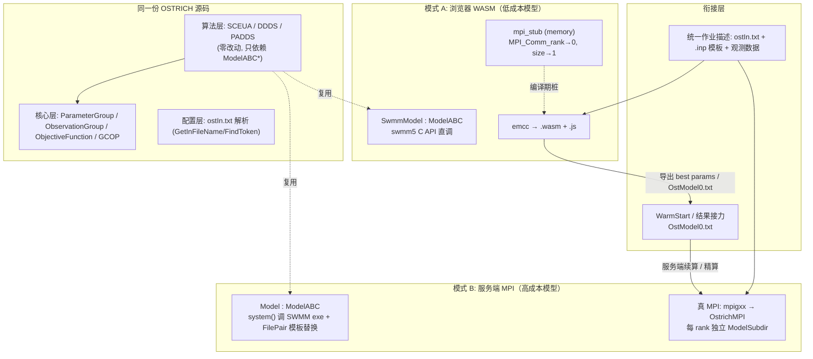
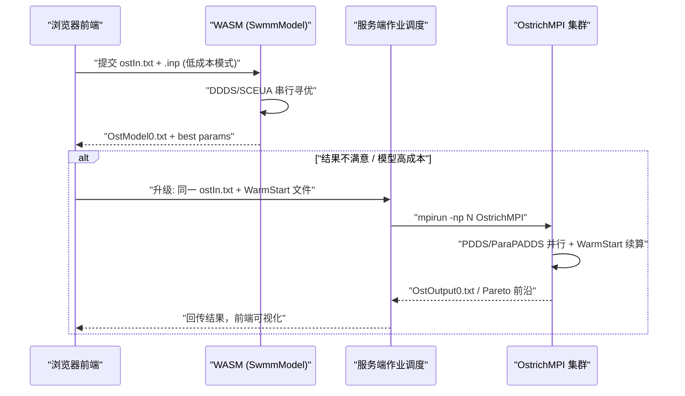
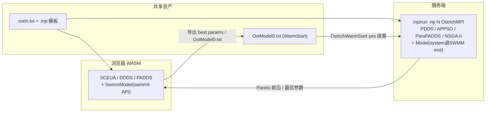

# 同一份 OSTRICH 源码 + 两个编译目标的完整解决方案

# 完整解决方案总结

**高层次的目标**：1）面向低成本模型时，在浏览器端采用 WASM 模式，直接单进程寻优；2）面向高成本模型时，采用服务端完整的并行和MPI加速模式，进行寻优。

**核心思路：同一份 OSTRICH 源码 + 两个编译目标**——浏览器端用 emcc + memory MPI stub 编译出 WASM 模块（`SwmmModel` 直调 SWMM C API），服务端用 `make GCC_MPI` 编译出 `OstrichMPI`（`mpirun -np N` 单机多核到集群无缝扩展）。两侧共享算法代码、`ostIn.txt` 配置与 `OstModel0.txt` 结果格式，通过 WarmStart 实现"浏览器粗搜 → 服务端精算"接力。

**衔接的关键：不需要两套系统——OSTRICH 本身就是"同一份源码、双模式编译"设计的。** 串行版（`make GCC`）和 MPI 版（`make GCC_MPI`）编译的是同一批 `src/*.cpp`，区别只在于链接 `extern/stubs/memory`（MPI 桩）还是真实 MPI 库 makefile:37-46 。你只需把这一思想扩展为：**WASM 端 = 串行桩 +** `SwmmModel`**（进程内 SWMM API）；服务端 = 真 MPI + 原生** `Model`**（**`system()` **调 SWMM 可执行文件）**，两侧共享全部算法代码、`ostIn.txt` 配置格式和 `OstModel0.txt` 结果格式。

# 双模式衔接架构



# 推荐的衔接工作流



# 算法选型矩阵

## 单目标（SWMM SCS-CN 率定、单目标调度）

| 算法                     | 性质      | WASM     | MPI 加速                              | 适用场景                                                        |
| ---------------------- | ------- | -------- | ----------------------------------- | ----------------------------------------------------------- |
| SCE-UA (SCEUA_PROGRAM) | 串行全局    | ✅ 首选     | ❌                                   | 水文率定黄金标准（专为概念性降雨径流模型而生）                                     |
| DDS (DDS_PROGRAM)      | 串行单点    | ✅ 预算受限首选 | ❌                                   | 模型昂贵、评估预算有限时收敛最快                                            |
| DDDS (DDDS_PROGRAM)    | 串行单点+离散 | ✅ 泵闸调度首选 | ❌                                   | PerturbParam 强制 ±1 离散扰动，适配闸孔档位/机组开停（IntParam/ComboStrParam） |
| PSO (PSO_PROGRAM)      | 可并行     | ✅ 可用     | ✅ EvalSwarmParallel+BcastSwarm 同步并行 | 种群式单目标备选                                                    |
| PDDS / APPSO           | 仅并行     | ❌        | ✅ master-slave / 异步                 | 服务端专属                                                       |
| GA/BGA                 | 串行      | 可用       | ❌ 无并行切分                             | 已被 PSO/SCE-UA 替代                                            |
| Powell                 | 串行局部    | ✅        | —                                   | 全局结果局部抛光                                                    |

## 多目标（泵闸联合调度：排涝 vs 能耗 vs 风险）\

| 算法                             | 性质           | WASM  | MPI 加速                        | 适用场景                                              |
| ------------------------------ | ------------ | ----- | ----------------------------- | ------------------------------------------------- |
| PADDS (PADDS_PROGRAM)          | 串行 Pareto 存档 | ✅ 首选  | ❌                             | 已验证，4 种选择度量（随机/拥挤距离/超体积）                          |
| ParaPADDS (PARA_PADDS_PROGRAM) | 异步并行版        | ❌     | ✅ 首选                          | 服务端昂贵模型多目标主力 multisearch_padds_async.html:123-125 |
| NSGA-II (NSGAII_PROGRAM)       | 可并行          | ✅ 可选  | ✅ func_parallel 按 rank 分摊种群评估 | Pareto 前沿覆盖度好，预算开销大                               |
| MOPSOCD / PAES                 | 可并行          | 可选    | ✅                             | PSO 复用度高、前沿多样性弱于 NSGA-II                          |
| SMOOTH                         | 串行随机         | ✅ 测试用 | —                             | 打通 Execute(pF, nObj) 多目标链路                        |

**推荐组合**：WASM = SCE-UA + DDDS + PADDS（+SMOOTH 验证）；服务端 = PDDS/APPSO + ParaPADDS（+NSGA-II）。并行能力依据：PSO 头文件有 MPI buffer 与并行函数，GA 完全没有 。

# 编译配置

## 客户端 / WASM

```text
emcc -std=c++17 -I include -I extern/stubs/memory \
    src/*.cpp(裁剪后) extern/stubs/memory/*.c \
    wasm_bridge/*.cpp third_party/swmm5/*.c \
    -sFORCE_FILESYSTEM -o ostrich_swmm.js/.wasm
```

- MPI 层：复用官方 extern/stubs/memory（MPI_Comm_rank→0、MPI_Comm_size→1），Bookkeep 自动退化为串行 makefile:12-15 Model.cpp:1454-1461 。
- 模型层：新增 SwmmModel : public ModelABC，Execute() 内部走".inp 内存 token 替换 → swmm_step 循环 → swmm_get*Result 直读 → CalcObjFunc"，替代原生 Model 的 system(m_ExecCmd)（WASM 不可用） Model.cpp:1561-1563 。
- 文件 I/O 裁剪：SCE-UA 的 sce.in/sce.out 、DDS 的 OstDDSPn.txt、关闭 m_bCaching（CheckCache 是 O(N²) 文本扫描） Model.cpp:1537-1547 ；MEMFS 仅承担 ostIn.txt/模板/结果导出的冷路径。
- 导出入口：SCEUA_Program、DiscreteDDS_Program、PADDS_Program 均为 extern "C" 。

## 服务端 / MPI

```text
make GCC_MPI                # mpigxx → OstrichMPI
mpirun -np N OstrichMPI     # N=4~32 单节点，N=1 可退化串行
```

- 单节点 MPI 走共享内存传输，通信量仅每次评估几个 double Model.cpp:1471-1479 。
- 隔离机制现成：每 rank 独立 ModelSubdir{rank} 目录 + OstModel{rank}.txt/OstErrors{rank}.txt 输出 Model.cpp:295-302 。
- ostIn.txt 需配 ExtraFiles/ExtraDirs/ModelSubdir；OstQuit.txt 优雅中止；OstrichWarmStart yes 续算 running.html:206-216 running.html:250-255 。
- 注意：非并行算法在 MPI 下无加速（各 rank 冗余跑串行搜索），须选 PDDS/APPSO/ParaPADDS/NSGA-II running.html:229-232 。

## 衔接数据流



### 说明

- 该图表达的是：两侧共享 `ostIn.txt` 配置与 `.inp` 模板；WASM 端跑串行算法（SCEUA/DDDS/PADDS + `SwmmModel` 进程内 SWMM API），服务端 `mpirun -np N` 跑并行算法（PDDS/APPSO/ParaPADDS/NSGA-II + 原生 `Model` 的 `system()` 调用） Model.cpp:1561-1563 。
- 接力机制：WASM 导出 `OstModel{id}.txt` 格式的评估历史（`Model::Write()` 的行格式 `Run obj.func obs... params...`） Model.cpp:1715-1784 ；服务端在 `ostIn.txt` 中配 `OstrichWarmStart yes` 即可从该文件续算（构造器中 `m_bWarmStart = true` 并 `RestoreRandomSeed()`） Model.cpp:816-829 。

关键一致性要求：`SwmmModel::Write()` 输出与 `OstModel{id}.txt` 同格式行（`Run obj.func obs... params...`），保证 WASM 产物可直接做服务端 WarmStart 输入 Model.cpp:1770-1783 ；两侧 SWMM 版本需对齐避免缓存错配。

# 实施顺序

1. WASM：`ModelEvaluation` 打通评估回调 → DDDS → SCE-UA（改文件 I/O）→ SMOOTH 验证多目标 `Execute(pF,nObj)` → PADDS。
2. 服务端：`make GCC_MPI` → 验证 `mpirun -np 1` 与串行等价 → `ModelSubdir`+`ExtraFiles` 配好 → `np=4/8/16/32` 实测吞吐曲线（SWMM 内存带宽可能先于 MPI 到瓶颈）。
3. 路由：前端按"单次模拟耗时 × 评估预算"自动选择 WASM 直跑或提交服务端。

# Notes

- `GCC_DB`（disk stub）仅供无 MPI 环境调试并行逻辑，非性能方案 building.html:224-233 。
- Docker 化服务端时注意 `mpirun --allow-run-as-root` 与 `/dev/shm` 共享内存设置。
- DDDS 仅单目标；"多目标+离散"需 PADDS + `IntParam` 编码组合 。
